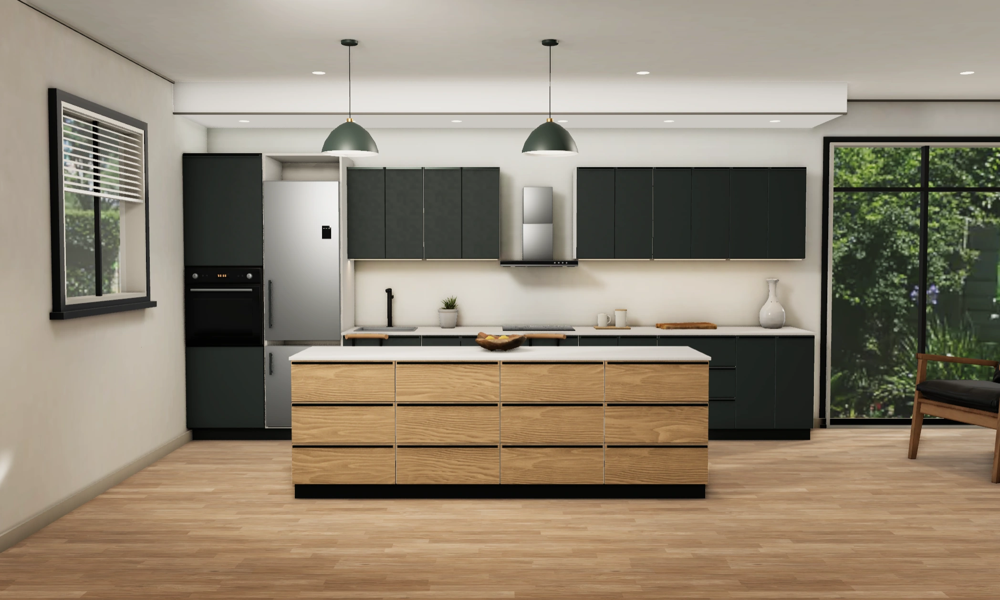

# Kitchen & Wardrobe Showroom

A white-label 3D showroom for kitchen and wardrobe makers. Customers walk through furnished rooms, change fronts, worktops and handles, add or replace units, and leave with a priced PDF offer. It runs entirely in the browser, works offline, and can carry any company's name, logo, colours and catalog.



## Features

- **Furnished 3D rooms:** straight, L-shaped and island kitchens; straight and corner wardrobes, in rooms with windows, a garden view, lighting and furniture.
- **Styles:** ready-made looks, front colours and materials, front styles, handles, worktops, floors and wall colours, all chosen from pictures.
- **Easy editing:** add units by tapping or dragging picture cards, and the app shows where each one fits. You can also replace, resize or delete units, and furnish wardrobe interiors with shelves, rails, drawers and baskets. Undo and redo work throughout.
- **Room sizes:** resizing keeps the design. Units widen, narrow or are added, and essentials such as the sink, hob and fridge always stay.
- **Pricing and offers:** prices come from the catalog per unit and size, with installation and VAT. A summary page and a branded PDF offer are included.
- **Branding:** each company is a folder with its brand file, catalog and logo. A built-in setup page previews and exports new brands.
- **Languages:** Albanian, English and German. Prices in EUR, sizes in cm.
- **Offline:** it installs as a PWA and keeps working without an internet connection once loaded.

## Tech stack

React, TypeScript and Vite · Three.js with React Three Fiber and drei · Zustand · Tailwind CSS · jsPDF · vite-plugin-pwa. There is no backend: designs and settings are saved in the browser.

## Getting started

Requires Node 24 and pnpm.

```sh
pnpm install --frozen-lockfile
pnpm dev          # development server
pnpm test         # unit tests
pnpm build        # type-check, production build and asset budget check
pnpm preview      # serve the production build (offline caching works here)
```

Copy `.env.example` to `.env` to configure the build:

| Variable | Purpose |
| --- | --- |
| `VITE_DEFAULT_BRAND` | Brand folder used when the address names none |
| `VITE_SETUP_PIN` | PIN for the `/setup` page. Set your own; the PIN is a convenience, not authentication |
| `VITE_BRAND_BASE_DOMAIN` | Enables `<brand>.<domain>` addresses |
| `VITE_DEMO_CONTACT_PHONE` | Fallback phone number for the demo brands |

## Brands and catalogs

Brands live in `public/brands/<folder>/`:

- `brand.json`: company name, contacts, colours, languages, and the legal and bank details printed on offers.
- `catalog.json`: modules, finishes, worktops, handles and all prices. Schemas are in `src/catalog/types.ts`.
- The logo file.

Open a brand with `/?brand=<folder>`. The `/setup` page builds a new brand from a logo and a few fields, previews it, and exports a ZIP to unpack into `public/brands/`. `default` (Forma Studio) and `druri-design` are fictional demo brands with sample prices.

## Deploy

The output is a static site in `dist/`. Serve it over HTTPS with a single-page fallback to `index.html`. `vercel.json` (Vercel) and `public/_redirects` (Netlify) are included. Don't cache `sw.js` as immutable.

## Project structure

| Path | Contents |
| --- | --- |
| `src/app` | Routes, Home, Summary, Settings |
| `src/designer3d` | The designer: layout rules, editing, cameras, panels |
| `src/scene` | Rendering, materials, rooms, lighting, models |
| `src/catalog`, `src/pricing`, `src/documents` | Schemas, price calculation, PDF offers |
| `src/brand`, `src/i18n`, `src/persistence` | Branding, translations, saved designs |
| `public/shared` | Textures, models, previews, fonts and room data |
| `scripts`, `art` | Asset preparation and review tooling (Blender is used offline only) |

## Assets and licences

Models and textures are original work or CC0 (Poly Haven, ambientCG). Sources are listed in [`public/shared/ASSETS.md`](public/shared/ASSETS.md), and the font licences are in `public/shared/fonts/`.
