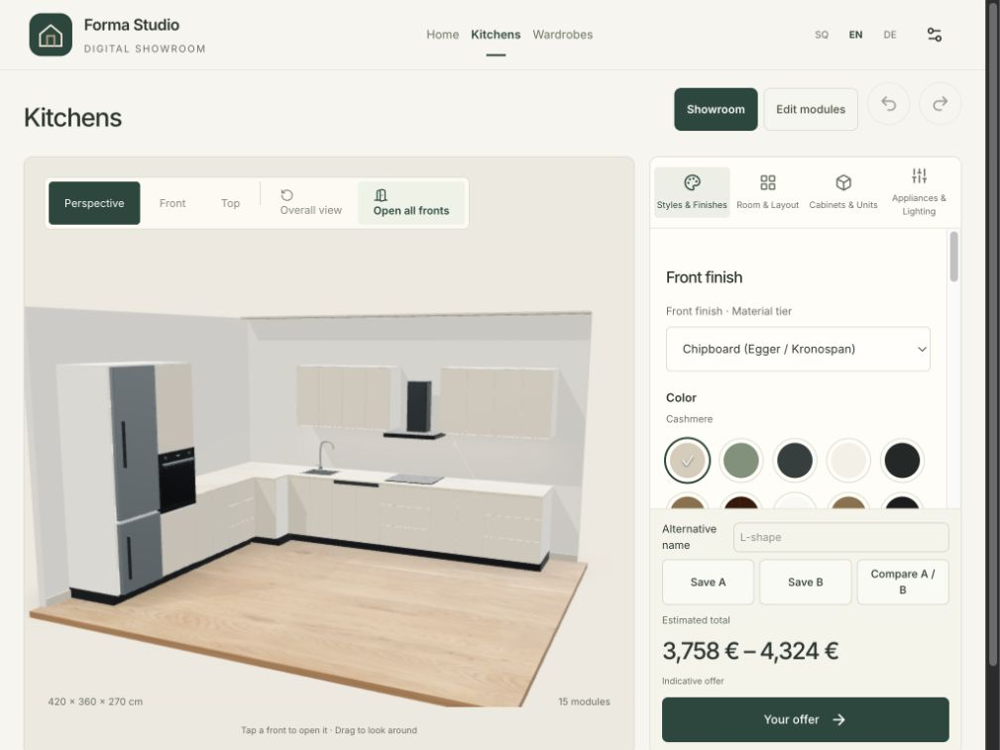
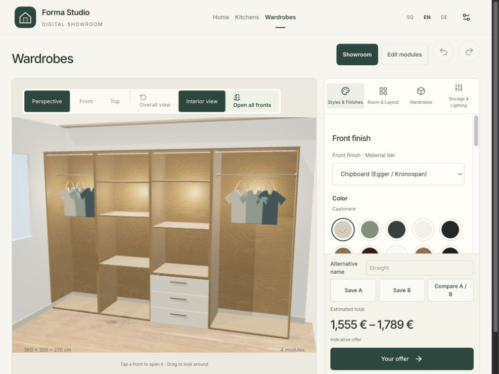
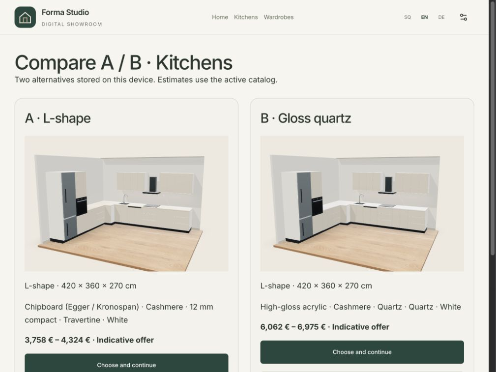

# Furniture-only cleanup — 11 October 2026

The standalone doors/windows and interior doors/flooring products have been permanently removed from the current project and rebuilt production output. No archive, replacement specialist experience, deployment, Git-history rewrite or commit was created. Existing uncommitted furniture work was preserved.

## Removed

- `src/doorPreview/`, `src/interior/`, specialist `src/scene/Product.tsx` and `products.ts`; their routes, stores, procedural products, photo projection/masking, scene loading and interaction code.
- The complete `public/brands/drita-home/` brand. Specialist product/finish/price groups and flags were stripped from both surviving catalogs/configurations and their schemas.
- `public/shared/interior/`, `public/shared/scenes/`, specialist showroom thumbnails, door/facade/interior illustrations, floor product textures and unused source-JPG duplicates. Only the five furniture thumbnails remain.
- Specialist branches in pricing, PDF offers, finish descriptions, sharing, persistence, dev preview tooling, navigation and the QA harness. Removed the unused photo database API and specialist rendering postprocessing. Cabinet rendering retains its existing direct rendering path.
- Four specialist test files (`exterior`, `interior`, `interior-photo`, `portal`), specialist cases in mixed suites, three obsolete asset-generation scripts, unused CSS rules and translation strings.
- Specialist verification folders, screenshots, generated offers and obsolete mixed reports/logs; Finder metadata.

The [complete deletion inventory](removed-files.md) lists every removed file with its original size. Remaining furniture reports are historical evidence, not this release’s current test results.

## Preserved intentionally

Kitchen and wardrobe design/catalog versions, product IDs, local drafts, furniture share links, A/B storage, brand setup, pricing formulas and PDF offers remain. Older branding with now-obsolete module flags is accepted and those flags are discarded by the schema. Unsupported specialist share payloads are rejected.

Cabinet doors, wardrobe Interior view, room door/window openings, laminate countertops and laminate/tiles/concrete room-environment maps are furniture functionality. They are retained and covered by asset/layout tests. No standalone openings or flooring product catalog remains. All remaining dependencies still have furniture/shared-runtime uses.

`/preview` and `/designer/interior` no longer have product implementations. Direct navigation displays the ordinary unknown-route furniture homepage; the URL itself is not redirected. Old specialist browser-local data is not migrated or exposed; this cleanup does not erase a user’s browser storage or rewrite Git history.

## Measured production savings

Fresh production builds immediately before and after this cleanup, using the same workspace/runtime. Values below are bytes except URL counts; MB in the user summary is decimal. Static assets/data excludes the emitted `assets/` folder and JavaScript/HTML; it includes catalogs, textures, thumbnails, fonts, icons and other public files. Categories overlap with total shipped size and must not be added together. Gzip is reproducible per-file compression, not measured network transfer.

| Measure | Before | After | Saving |
| --- | ---: | ---: | ---: |
| Production directory | 9,119,106 | 5,264,586 | 3,854,520 (42.3%) |
| Unique offline precache | 9,077,387 | 5,238,811 | 3,838,576 (42.3%) |
| Unique precache URLs | 154 | 84 | 70 (45.5%) |
| JavaScript, all chunks and workers | 2,861,897 | 2,636,172 | 225,725 (7.9%) |
| JavaScript, summed individual gzip | 885,019 | 807,410 | 77,609 (8.8%) |
| CSS | 61,315 | 42,084 | 19,231 (31.4%) |
| Static assets and data | 5,970,848 | 2,361,391 | 3,609,457 (60.5%) |

Reproduce the current numbers with `python3 verification/furniture-only/measure-build.py /tmp/current-build-sizes.json`. See [sizes.json](sizes.json), [build log](build.txt) and [test log](tests.txt). The rebuild removes stale specialist chunks/assets from `dist`; the offline precache falls from 154 to 84 unique URLs. Both shipped and precache totals now fit below the existing 9 MB warning threshold and 10 MB ceiling.

## Verification performed on the cleaned production build

- **68 tests passed across 9 files.** Covers layouts/presets, collision validation, history/open state, material tiers, storage measurements, framing, price/PDF calculations, share round trips, catalog/assets and A/B persistence/isolation/failure behavior. Added regression coverage for old furniture branding flags and retained environment/preset assets.
- **Production build and TypeScript passed.** `git diff --check` passed. Source/public/catalog scan found no specialist imports, runtime routes, brand references or product data. Obsolete names only remain in negative compatibility tests and this cleanup documentation.
- **@Browser only**, production `localhost:4173`: accepted the service-worker update and verified loaded `index-CWGtMNOC.js` matches the built entry, rather than testing the stale prior bundle.
- Existing saved 15-module kitchen loaded unchanged (420 × 360 cm; €3,758–4,324). Front-family change and undo/redo worked. Existing alternatives refreshed previews against the reduced catalog, kept their estimates (A €3,758–4,324; B €6,062–6,975; B minus A €2,478), restored into the editor and saved again.
- Straight wardrobe loaded, Interior view revealed shelves/rails/drawers, open/close-all worked, and the offer remained €1,555–1,789.
- Settings showed only Forma Studio and Druri Design. Salesperson setting survived reload and was restored to blank after the check. Brand switching, PIN setup and brand ZIP export worked; the ZIP’s catalog contains only furniture groups and its flags only enable kitchen/wardrobe.
- Both retired URLs displayed Home. Tablet landscape 1024 × 768, portrait 820 × 1180 and phone 390 × 844 were checked. No horizontal document overflow was measured on phone/portrait. Existing visual limitations remain; this cleanup is not a new realism approval.
- Stopped the preview server and confirmed no listener on 4173. Reloaded wardrobe from the prepared cache, navigated to kitchen and opened populated A/B comparison with images and estimates. Restarted the local preview afterward. No browser console errors were captured during this verification.
- Downloaded fresh English kitchen and wardrobe PDFs and rendered/inspected **all four pages**. Each offer occupies two legible pages with materials/units, dimensions and totals. The pricing/PDF test suite covers the surviving document calculations; SQ/DE visual PDFs from the previous furniture release were not rerendered in this removal pass.

## Current evidence

Additional evidence: [phone wardrobe](screenshots/wardrobe-phone.jpg), [portrait wardrobe](screenshots/wardrobe-portrait.jpg), [kitchen PDF](pdfs/kitchen-en.pdf), [wardrobe PDF](pdfs/wardrobe-en.pdf). All PDF page renderings are in `pdfs/`.

## Limits

No regressions were found in these checks; this is not a guarantee of every device or catalog combination. Physical tablet touch, sustained GPU performance, installed-PWA lifecycle, native sharing and operating-system PDF handling still require device rehearsal. No deployment or manufacturer/meeting-readiness approval is implied.
