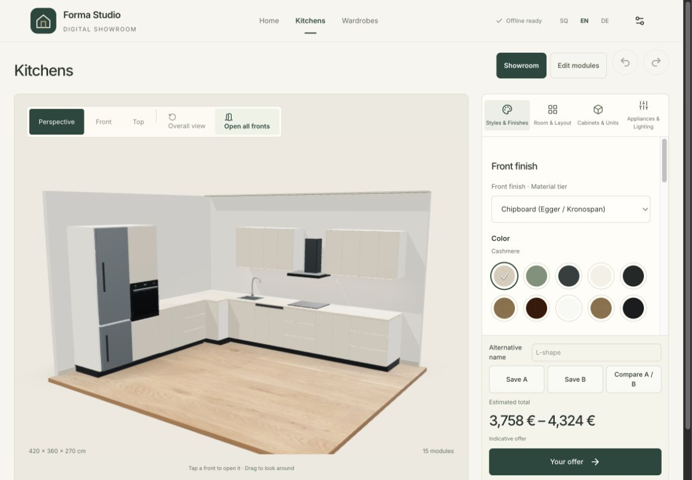
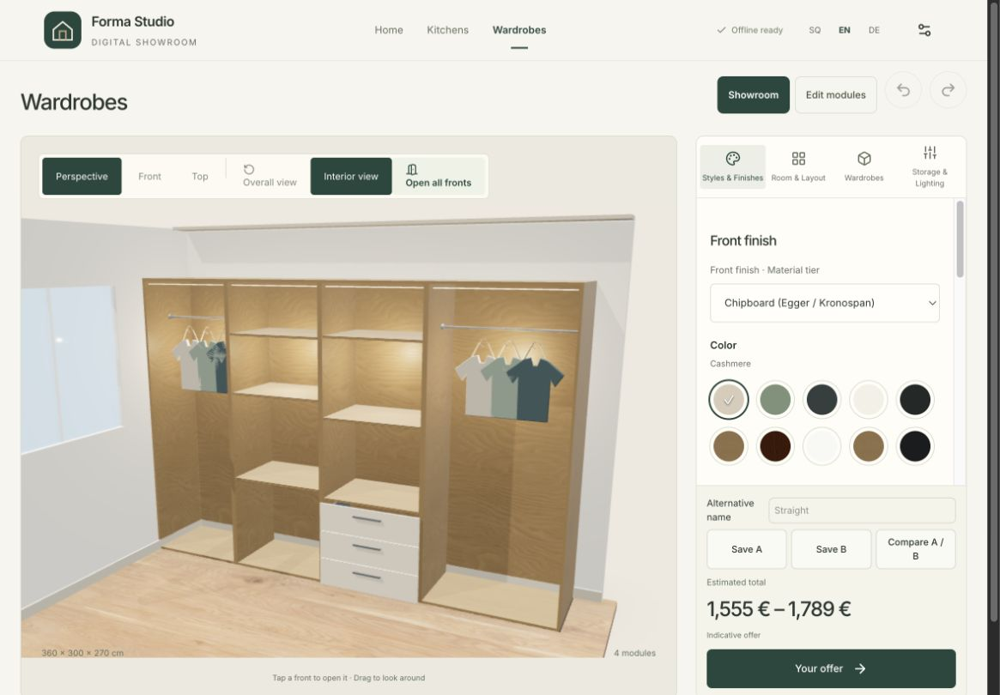

> Historical furniture release verification (10 October). For the current furniture-only build and test counts, see [the cleanup report](../furniture-only/REPORT.md).

# Furniture sales demo — local verification

Verified 10 October 2026. Scope: the approved kitchen/wardrobe sales demo, using bundled assets. No deployment, supplier asset sourcing, certification claims or manufacturing output. Browser work used **@Browser exclusively**.

## Result and acceptance boundary

**This is technical verification and a visual review candidate, not owner approval or a claim of meeting readiness.** Review the two representative views below. A physical tablet rehearsal remains outstanding.

## Implemented behavior

- Both furniture catalogs contain three authored kitchens and two wardrobes, with compatible finishes and presentation cameras. Existing preset identifiers remain; the straight wardrobe adds an identifier. Existing saved designs are not regenerated on load. U, parallel and walk-in layouts remain in editing.
- Material families expose their listed decors, preserve compatible selections and otherwise select the first available decor. Collections affect finishes, not arrangements. The material preview uses the same curated design and transfers its selections into the editor.
- Showroom/Edit is explicit. Showroom taps inspect/open; editing is deliberate. Selected/open cabinet IDs are reconciled through regeneration and history. Brand/type transitions clear transient state.
- Wardrobe Interior view is temporary. Shared storage measurements drive shelf/rail/drawer geometry and the inspection information. Counts and approximate clearances replace unsupported capacity claims. Existing opening/sliding/drawer demonstrations remain separate.
- A/B alternatives use a dedicated IndexedDB database, separated by brand and furniture type. Each has a named validated snapshot and a closed overall capture. Customer/offer personal fields are omitted; choosing a design retains the active offer details. Failed captures/storage preserve the previous slot. Incompatible catalog references block restoration; changed compatible catalogs trigger sequential preview refreshes.
- Offers show material family/decor and units, omit empty personal rows, group dimensions, and keep installation/tax/total together. Gola remains the same per-position pricing calculation and is labelled as an indicative allowance. No pricing formula was intentionally changed.
- Furniture thumbnails were captured from the application's own geometry. The asset ledger records them; no external assets were acquired.

## Automated verification

| Check | Result |
| --- | --- |
| `pnpm test` | **113 tests passed, 13 files** |
| `pnpm build` | **Passed**, including TypeScript and PWA generation |
| Asset budget | 9,112,958 shipped bytes; 9,077,387 unique precache bytes / 154 URLs. Below enforced 10 MB ceiling; **above 9 MB working target** |
| `git diff --check` | Passed |

Tests cover authored layouts, generated layout adjacency, compatibility-aware material selection, stale selected/open state, undo/redo, camera framing, storage clearances, countertop heights, pricing/units, multilingual pagination, A/B isolation/privacy/overwrite/selection and failure preservation. Comparison storage unit tests mock the IndexedDB boundary; actual browser persistence was separately exercised below.

## Hands-on browser verification

Development ran on `localhost:5173`; the built production preview ran on `localhost:4173`. Listener presence was checked, and the final loaded script matched `dist/index.html` (`index-C53XjMir.js`). Final HTML metadata was also verified after the last update.

| Exercise | Observed result / evidence |
| --- | --- |
| All five featured presets | Opened from Home and captured; explicit arrangements and estimates loaded. [Straight kitchen](screenshots/kitchen-straight-1180.jpg), [island](screenshots/kitchen-island-1180.jpg), [corner wardrobe](screenshots/wardrobe-corner-1180.jpg) |
| Material families | All five front and four countertop families exercised during development verification; final production checked chipboard → acrylic/quartz and Fenix/laminate. Decors and totals changed. Family compatibility also covered by tests. |
| Material preview → editor | Fenix / Soft black / 38 mm laminate transferred with the authored L arrangement. Selected family values and visible decor headings checked in the editor. |
| Wardrobe storage | Interior exposed rails, shelves and drawers. A direct pointer tap selected the drawer compartment, opened it and showed 76.4 × 56.5 cm internal width/depth, three shelves and three drawers. [Inspection](screenshots/wardrobe-inspection-final.jpg) |
| LED on/off | Interiors remained visible with lighting disabled. [LED off](screenshots/wardrobe-led-off-final.jpg) |
| History/regeneration | Material undo/redo and wardrobe regeneration after opening fronts were exercised; stale opening state cleared. Regression tests cover surviving IDs and selection reconciliation. |
| A/B and reload | Saved Cashmere compact A and Gloss quartz B, reloaded comparison, and restored A. Displayed ranges were 3,758–4,324 € and 6,062–6,975 €; B−A central-estimate difference +2,478 €. [Comparison](screenshots/comparison-final.jpg) |
| Brand isolation | Druri Design comparison showed empty A/B while default retained its alternatives. Wardrobe slots stayed separate from kitchen. |
| Tablet landscape | 1180×820 and 1024×768 tested. Scene and estimate remained visible; controls scrolled independently. [1024 kitchen](screenshots/kitchen-1024.jpg) |
| Portrait / phone | 820×1180 and 390×844 tested. Controls appeared beneath the scene, price was in normal flow. DOM scroll widths equalled client widths (805 and 375 px with scrollbar), without horizontal overflow. [Portrait](screenshots/kitchen-portrait.jpg), [phone](screenshots/kitchen-phone.jpg) |
| Production console | No error entries returned by the final production-tab error-log check. |

Screenshots use CSS viewport dimensions; captured image bounds may exclude browser scrollbar pixels. Earlier screenshots with `1024`/`1180` names not linked above are intermediate records. The `final` images and linked straight/island/corner/responsive images reflect the final rendering changes.

### Service worker and prepared offline flow

The update prompt was exercised across production rebuilds. The latest update applied via **Save and update**, preserved the active design, and loaded the revised furniture-only metadata. An intermediate rapid rebuild/update/navigation sequence produced a blank tab; reopening that tab loaded the current bundle. The final update was repeated successfully without that recovery. Avoid rebuilding the served directory during a meeting; deployed update behavior still needs rehearsal on the target device.

After the final update and ready state, the production preview process was stopped. `lsof` confirmed no listener on port 4173. With the origin unavailable, @Browser successfully:

1. Reloaded the prepared kitchen and loaded its geometry/materials.
2. Opened saved A/B alternatives and restored A.
3. Opened the offer and downloaded a two-page English PDF.
4. Navigated to the prepared wardrobe and enabled Interior view.

The preview server was restarted afterward. [Offline offer screenshot](screenshots/offline-offer.jpg) · [offline PDF](pdfs/offline-kitchen-en.pdf).

This is an origin-unavailable cached-flow test, not radio/network emulation, first-visit offline support or proof against storage eviction.

## PDF verification

Six representative offers were exported through the application for cashmere L kitchen and straight wardrobe in **SQ, EN and DE**. All were rendered with Poppler and every page visually inspected. Each had two A4 pages: overview/materials, then configuration/details/totals. Text, accented characters, explicit quantity units and totals remained legible without clipping. Empty customer/salesperson rows were absent. Longer-content pagination remains allowed and is tested.

| Design | SQ | EN | DE |
| --- | --- | --- | --- |
| Cashmere L kitchen | [PDF](pdfs/japandi-sq.pdf) / [pages](pdfs/japandi-sq-preview.jpg) | [PDF](pdfs/japandi-en.pdf) / [pages](pdfs/japandi-en-preview.jpg) | [PDF](pdfs/japandi-de.pdf) / [pages](pdfs/japandi-de-preview.jpg) |
| Straight wardrobe | [PDF](pdfs/wardrobe-straight-sq.pdf) / [pages](pdfs/wardrobe-straight-sq-preview.jpg) | [PDF](pdfs/wardrobe-straight-en.pdf) / [pages](pdfs/wardrobe-straight-en-preview.jpg) | [PDF](pdfs/wardrobe-straight-de.pdf) / [pages](pdfs/wardrobe-straight-de-preview.jpg) |

The additional final-production English PDF downloaded with the server stopped was also rendered and both pages inspected. It remained two pages and matched the restored A estimate.

## Remaining limitations and next review

- **Visual judgment:** the warm stage and readable storage are an improvement in coherence, but the models are still procedural. Appliances, clothes, corner internals and some surface mapping remain simplified. Large wardrobe panels repeat/stretch the bundled grain visibly. Pale kitchen front seams and handles remain subtle at normal tablet distance. These are not manufacturer-specific product assets or a promise of photorealism.
- Matte/gloss and compact/laminate now have different rendering parameters and geometry; their perceptual strength varies with the camera, finish and device. Owner review should judge whether the visible difference is strong enough for the intended sales conversation. Physical samples are still necessary.
- The existing bundled stone/wood textures and decor names are illustrative. They do not establish a supplier-authentic match. Any manufacturer model/texture/photo replacement requires a separate approved sourcing scope.
- The download pipeline is functional but device/browser speed varies. No physical tablet timing or long-session memory/performance benchmark was measured.
- Final approval requires an actual tablet rehearsal: touch selection/orbit/edit movement, several sustained material/layout changes, closing/reopening the installed app, offline reload, PDF download and native sharing. No messages were sent during verification.
- A/B is local to the browser/origin and may be lost if storage is cleared/evicted. It has no account sync or shared comparison link. The selected design retains the existing single-design share/PDF behavior.
- No deployment was performed. No claim of visual approval, supplier certification, manufacturing accuracy or readiness to close a deal is made by this report.
